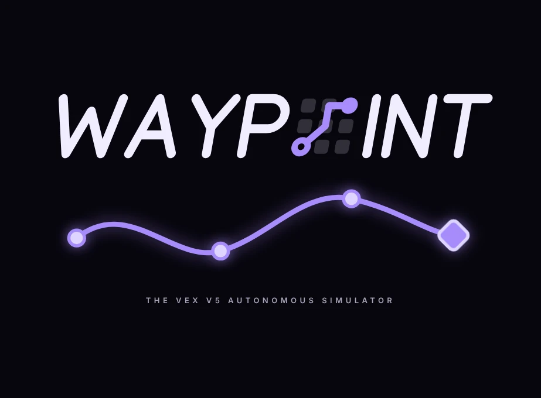

<p align="center"></p>

<p>
<picture>
  <source srcset="assets/invictus-52111a-light.svg" media="(prefers-color-scheme: dark)">
  
</picture>
<br>Made by <b>Invictus 52111A</b>
</p>

**Waypoint** is a drivetrain-only autonomous simulator for the **VEX V5 Override** field.
It runs your **LemLib** auton code (C++ or JavaScript), follows **path.jerryio** files, and lets you scrub the result on a timeline.

It includes a **path editor** ported from [path.jerryio](https://github.com/Jerrylum/path.jerryio), so you can draw and tune paths right on the field, and its Override field pictures. Because of that this project is licensed **GPL-3.0** (see `LICENSE` and `NOTICE.md`).

Only the drivetrain is simulated. Intake, lift, claw and the like are ignored, and the game elements (goals, loaders, toggles, cups, pins) are visual only.

## Running it

| How | Steps |
|---|---|
| **Simplest** | Double-click `index.html`. Works straight from the file, nothing to install. |
| **Standalone server** | Double-click `start.bat` (starts a local server and opens the browser). |
| **Rack** | **+ Add app** → point at this folder → **Save**. Run `setup.bat` once, press **Start**, click **Open sim**. |

`run-sim.bat` is the foreground launcher Rack uses. It serves the folder on `%SIM_PORT%` (Rack sets it, default `8137`) using Python if installed, otherwise the PowerShell that ships with Windows. It never opens a browser or waits for a keypress.
There is no build step, so there is no `rebuild.bat`.

## Using the sim

1. **Start pose** - set X / Y / heading on the field (or drag the dashed robot; drag the yellow handle to turn it).
   **`0, 0, 0` in your code is that pose**: `+y` is straight ahead of the robot, `+x` is to its right, heading `0°` is its starting direction. The red / green axes on the field show the code frame.
   **`chassis.setPose(x, y, theta)` at the start of your code sets the start pose** (field coordinates, `theta` is a compass heading, `0°` = up the field), so the robot starts where your code says and the Start pose numbers follow it. Untick *take the start pose from setPose()* to place the robot by hand instead. A `setPose()` after the robot has moved only re-anchors the code's coordinates (the robot stays where it is, like on a real robot) and clears odometry error. All spellings work: `setPose(x, y, theta)`, `setPose(x, y, rad, true)`, `setPose(lemlib::Pose(x, y, theta))`, `setPose({x, y, theta})`, `setPose(pose)`. `getPose(radians, standardPosition)` works too.
2. **Drivetrain** - wheel diameter, wheel RPM, **real-life speed %** (how much of the theoretical top speed the robot really reaches), track width, robot size, motor response time and LemLib's horizontal drift.
   **Chassis** - how many wheels, which are omni and which traction (front to back), and optional forward / sideways tracking wheels, drawn top-down on an inch grid.
   **Real-life error** - one tickbox: gyro drift, wheel slip, sideways sliding and turn scrub, sized by your chassis (see below). On by default; untick it for a perfect robot.
3. **Path files** - drop in whatever jerry.io exported: LemLib `.txt`, a `.jerryio` project, or a LemLib v1.0 binary file. Each gets a name for your code: the file name with non-letters turned into `_`, e.g. `my path.txt` → `my_path_txt`, `curve.jerryio` → `curve_jerryio` (a file with several paths also gets each path's own name). Click the name to copy it.
4. **Auton code** - paste your `autonomous()` (or the whole `main.cpp`), press **Run auton** or `Ctrl + Enter`.
5. Use the timeline to play, pause and scrub. Click a line in the run log to jump to that motion. Keys: `Space` play/pause, `Home` rewind (stays paused), `←` `→` nudge 0.1 s.

### Drawing paths

Press **Edit paths** (above the field), or **New path**, then:

- click empty field: **Curve** or **Line** adds a segment from the last point (the first segment starts at the robot's start pose)
- click a point: **Delete** (end points; their segment goes with them). Drag points to move them; an end point takes its two handles with it, hold `Ctrl` to move it alone
- click a curve: **Convert** (curve <-> line) or **Split** (adds a point there)
- the **speed graph** under the field: click to add a speed point, drag it, double-click (or `Delete`) to remove it. Points on the field are coloured red (slow) to green (fast)
- **Selected path** panel: name, min / max speed, bend-rate range, max deceleration, point density
- `Ctrl+Z` / `Ctrl+Y` undo and redo

Paths you draw (or open from a jerry.io file) are used in code by their name (`Path 2` is `Path_2`), plus the file name for imported ones (`example.txt` is `example_txt`); click the name in the list to copy it.
**Export** writes a jerry.io project (`.jerryio`, opens in jerry.io), a LemLib v0.4 `.txt`, or a LemLib v1.0 `.bin`.

The field picture can be switched between the match field and the skills field.

### Path coordinates

| Mode | Meaning |
|---|---|
| **Field coordinates** (default) | The path sits on the field exactly as drawn in jerry.io (origin = field centre, inches). The sim converts it into your code frame, so it works for any start pose. Put the start pose where your path starts. |
| **Shifted to the robot** | The path keeps its shape and direction but is slid so its first point is on the robot when `follow()` starts. |
| **Code coordinates** | File numbers are used as-is in the odometry frame (what a real robot does if you never rebase them). |

Units come from the file's format (LemLib text = inches, path.jerryio = cm, v1.0 = mm, project files = the unit chosen in jerry.io); you can override them per file.

Dropping a file that contains the full jerry.io project (`.jerryio`, LemLib `.txt` / `.bin` exports, which embed it) opens its paths in the editor. Anything else is used as plain points.

Supported files: LemLib v0.4 text (with the ghost point), LemLib Tarball v0.5 and path.jerryio v0.1 text (`#PATH-POINTS-START` blocks), LemLib v1.0 binary (mm, m/s), and `.jerryio` project JSON. Speeds are converted to motor commands (0-127 and 0-255 are used directly, m/s is scaled to what the robot's wheels can do).

### Supported code

LemLib 0.5-style calls, with LemLib's blocking rules (`async` defaults to `true`, and starting a new motion waits for the previous one to finish):

`setPose` `getPose` `resetLocalPosition` `calibrate` `moveToPoint` `moveToPose` `turnToHeading` `turnToPoint` `swingToHeading` `swingToPoint` `follow` `waitUntil` `waitUntilDone` `cancelMotion` `cancelAllMotions` `isInMotion`, plus the `lemlib` helpers `Pose` (with `distance`, `angle`, `lerp`, `rotate`), `slew`, `sanitizeAngle`, `angleError`, `avg`, `ema`, `getCurvature`, `Timer` and `PID`, plus `pros::delay`, `pros::millis`, designated-initialiser params (`{.forwards = false, .maxSpeed = 80}`), `lemlib::DriveSide::LEFT`, `lemlib::AngularDirection::CW_CLOCKWISE`, simple `int / float / bool` variables, `if`, `for`, `while`, and several `void name()` routines (pick one in the **Routine** menu).

You can paste your **whole `main.cpp`**: the sim finds `autonomous()` (or the first routine with "auto" in its name), runs it, and ignores `initialize()`, `opcontrol()` and the rest. Other `void` functions with a body become helpers you can call (with arguments and default values), and `enum`s, `#define NAME value` and simple global constants are understood. If the file has several routines, pick one in the **Routine** menu; the run log says which one ran and which functions were ignored.

You can also paste just a **list of statements** (no `void autonomous() { ... }` around it).

**Lift / claw waits.** The sim only runs the drivetrain, so a loop like `while (liftPIDEnabled != 1) { pros::delay(20); }`, which waits for a lift task to finish, would never end. A loop whose body does nothing but `delay()` counts as already finished and **adds no time** (the run log notes it once). Loops that also do something (`while (i < 3) { i++; pros::delay(100); }`) run normally, and so do waits on the drivetrain (`isInMotion()`, `getPose()`, `millis()`). If you want each such wait to cost some time, set **Lift / claw wait** (Drivetrain settings, default 0) to a number of milliseconds. A loop that does something else while it waits on a lift is carried on after 500 ms.
**Functions that are not in your paste** (for example `resetAtGoalA()` defined in another file) are skipped and listed at the end of the run log. If one moves the robot, paste its definition too and it will run.

Anything on other objects (`intake.move(127)`, `clamp.set_value(true)`, `pros::lcd::print(...)`, ...) is ignored, and lambdas / `pros::Task` bodies are skipped.
It is a small translator, **not a C++ compiler**: classes, templates and pointer tricks are not supported. If a helper function cannot be translated you get a warning and calls to it are ignored; if the routine itself cannot be parsed the run log points at the line that probably caused it.

**Import drivetrain & gains from code** copies the numbers from your `lemlib::Drivetrain`, `lemlib::ControllerSettings` and odometry setup (`lemlib::TrackingWheel` offsets and the `lemlib::OdomSensors` line: forward / sideways tracking wheels and the IMU) into the sim settings and the Chassis panel. The `lemlib::Omniwheel` constants use the diameters from the LemLib docs (for example `OLD_4` is 4.18 in). The LemLib tuning card holds the PID values, exit conditions and slew.

The sim warns in the run log when `turnToPoint` / `swingToPoint` aims at a point within 10 in of the robot (LemLib's docs advise against it). Not simulated: driver control (`tank`, `arcade`, `curvature`, `ExpoDriveCurve`), `setBrakeMode`, the public `lateralPID` / `angularPID` members, and arithmetic on poses (`a + b`, `a * 2`).

## Things to know (accuracy)

* **LemLib behaviour** is a port of the **LemLib v0.5.6** source (PID, exit conditions, `moveToPoint`, `moveToPose`, turns, swings, `follow`, the motion queue and `minSpeed` / `earlyExitRange` chaining), so parameters behave as they do on the robot, including its quirks. For example, in v0.5.6 a `moveToPose` chain with a small `earlyExitRange` exits when the robot gets within 7.5 in of the target, and with a larger one it never takes the early exit and settles instead. The motors are modelled simply, so timing will not match a real robot exactly.
* **Physics** is a differential drive: wheel speed follows the motor command with a first-order lag ("motor response") and the robot cannot leave the field walls. There are no collisions with goals.
* **Real-life error** (tickbox in the panel of the same name; untick it for a perfect robot). The robot has a real pose and an odometry pose, and LemLib only ever sees the odometry one. Every **Run** (button or `Ctrl+Enter`) gives the robot a new random draw, so results vary like on a real field; re-runs after you change a setting keep the same draw (the run log prints its seed). The size of the errors comes from the **Chassis** panel:
  * **Gyro**: a bias in degrees per minute (random per run, and it wanders a little), a turn-rate scale error in % and reading noise. The odometry heading is the gyro's, so it drifts away from the real heading. A tracking wheel does not help here.
  * **Wheel slip**: the ground follows each side's wheel speed only as far as friction allows (forward grip x g), so hard starts spin the wheels and hard stops skid. Traction wheels grip more than omnis. With drive-wheel odometry the encoders count wheel travel, so the odometry over- or under-counts, and wheels that keep turning against a wall keep adding distance.
  * **Sideways slide**: turning at speed needs sideways grip (x g); beyond it the robot slides wide. Omni wheels give little sideways grip, traction wheels a lot, so traction wheels cut the drift.
  * **Turn scrub**: the robot turns a little less than its wheels say (effective track width above the measured one). It grows with sideways grip and with how far the wheels sit from the centre, so a traction wheel in the middle scrubs far less than one at the end.
  * **Consistency**: how much the grip changes from run to run (omni rollers vary more than traction treads).
  * **Heading source**: with an IMU the heading drifts as above. Without one, LemLib uses the wheels: with two forward tracking wheels the heading is good, with only the drive wheel encoders it is wrong by the wheel slip and scrub (LemLib's docs advise against it). Untick *IMU* in the Chassis panel to see it.
  * **Tracking wheels**: a forward tracking wheel measures how far the robot really travelled, so wheelspin, skids and pushing on a wall no longer fool the odometry; a sideways one also sees sliding. Each has a small size error per run, and an offset from the centre that the code compensates with the gyro (as LemLib does). `chassis.setPose()` resets the odometry error, like a wall reset.
  * The per-wheel numbers (grip, sideways grip, consistency) and the gyro numbers are typical, not measured on your robot: VEX publishes no gyro drift spec, VEX Forum posts report anything from a few tenths of a degree per minute at rest to a few degrees of error per full rotation, and the friction of omni wheels on foam tiles is not well documented either. They are constants in `js/chassis.js` and `js/sim.js`.
  * Not modelled: tracking-wheel lift-off or bounce, wheel diameter error on the drive wheels, battery sag, other robots and bumping into things.
* **Path files**: exported points and speeds are used as they are in plain-point files; paths opened in the editor are recomputed with the same speed rules jerry.io uses (even spacing along the curve, speed limits, bend-rate slowdown, keyframes, deceleration), so they can differ from the exported numbers by small amounts. Followed paths get a "ghost" tail past the end (like LemLib's) so the robot slows to a stop. If a file does not load, the run log says why.
* **Field**: the field pictures (match and skills) are path.jerryio's Override field images. They are pictures only: the goals, loaders and game elements on them are not simulated.

## Changes

See [`CHANGELOG.md`](CHANGELOG.md), or press **Changelog** in the app. After editing `CHANGELOG.md` run `node tools/make-changelog.js` to refresh the in-app copy (`js/changelog.js`); `node tests/engine.test.js` fails if it is out of date.

## Files

```
index.html, css/style.css       the page
CHANGELOG.md                    what changed, newest first (js/changelog.js is the in-app copy)
css/tokens.css                  colours, radii, spacing, fonts (dark / light, accent block)
js/theme.js                     Auto / Light / Dark switch
js/lemlib.js                    LemLib controllers + chassis (motions)
js/chassis.js                   wheel layout -> grip, scrub, odometry; chassis drawing
js/sim.js                       physics (incl. gyro drift + wheel slip), virtual clock, runs your code
js/translate.js                 C++ -> JS translator
js/paths.js                     jerry.io file parsing + speed profile
js/editor.js, js/export.js      path editor model, jerry.io-compatible export
js/pathtool.js                  path editing UI (field clicks, speed graph, list)
assets/field/                   Override field pictures (from path.jerryio)
assets/waypoint-logo.webp       the logo (README banner, start-up splash)
js/render.js                     canvas drawing (field picture, paths, robot)
js/app.js                       UI
examples/                       example.txt, example.jerryio, example_auton.cpp
rack.json, run-sim.bat, setup.bat, start.bat, serve.py, serve.ps1
tests/engine.test.js            node tests/engine.test.js
tests/editor.test.js            node tests/editor.test.js
tools/make-examples.js          regenerates examples/ and js/examples.js
tools/make-changelog.js         regenerates js/changelog.js from CHANGELOG.md
```

The **Theme** button cycles Auto (follows your system), Light and Dark. Settings, code and loaded path files are remembered in your browser (local storage).
